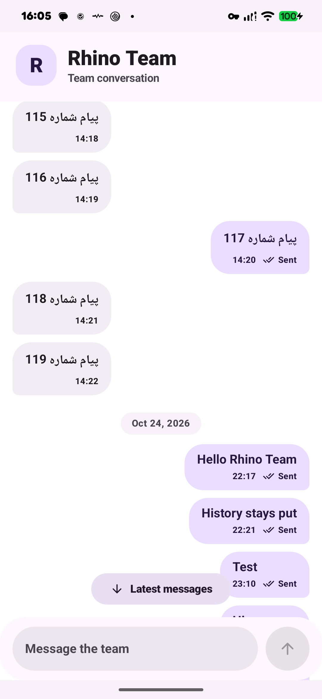
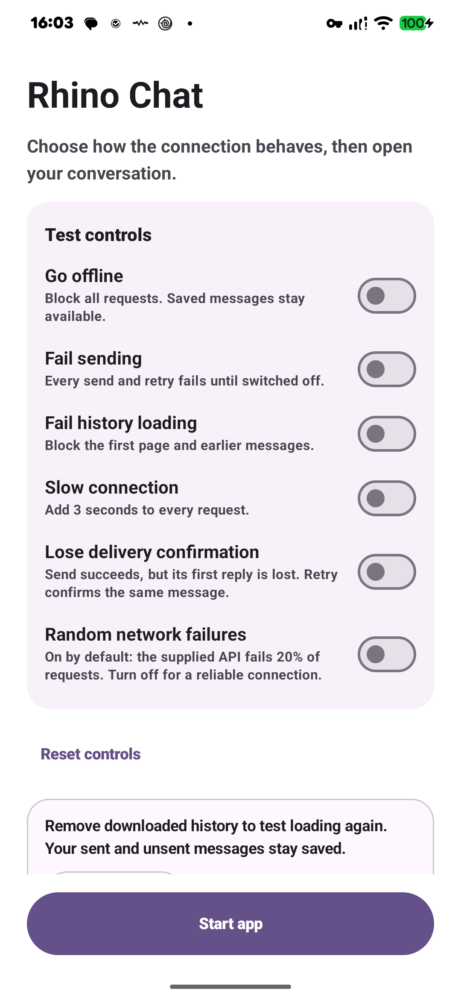

# Rhino Chat

An Android chat challenge built with Kotlin and Compose Multiplatform. I spent approximately **4 hours** on the project.

The app supports paginated history, offline caching, optimistic sending, and retry without duplicate messages. It also includes saved drafts, background retry with WorkManager, day separators, a jump-to-latest button, dark mode, and RTL support.

## Screenshots

Captured on a Pixel 7 Pro, with random failures switched off for the demo.

| Conversation | Test controls |
| --- | --- |
|  |  |

## Run

Open the project in Android Studio with **JDK 21** and **Android SDK 37**. Let Gradle sync, select **androidApp**, and run on a device or emulator with **API 24+**. The first screen lets you configure test conditions; tap **Start app** to open chat.

```sh
./gradlew :androidApp:assembleDebug
```

APK: `androidApp/build/outputs/apk/debug/androidApp-debug.apk`.

## Architecture

I used **MVVM with unidirectional data flow** to keep the screen separate from state and persistence. Room is the source of message data; the ViewModel owns UI operations, and the repository handles sending, retry and pagination. Koin provides the dependencies.

Chat is organized into `data`, `domain`, and `presentation` inside `shared`. `androidApp` hosts Android-specific wiring and WorkManager. This keeps the boundaries clear without adding extra modules or pass-through use cases. See [architecture notes](docs/ARCHITECTURE.md).

Messages are saved locally before sending, with a stable client UUID. Acknowledgements update the same row; retry reuses that UUID. History merges by identity, so overlapping pages do not create duplicate bubbles. Drafts are stored per conversation, and sending clears only the submitted draft.

## Test

```sh
./scripts/verify                    # Build, unit/integration tests, metadata and lint
./scripts/verify-ui <device-serial> # Compose UI tests on a connected, unlocked device
```

Tests cover send/retry, lost acknowledgements, cancellation, pagination, Room persistence/migration, drafts, and Activity recreation. UI tests use the real ViewModel/repository/Room with controlled transport responses in a separate test app, preserving the normal demo cache.

The latest focused run passed **28 unit/integration checks and two Pixel UI tests**, plus builds and lint. The full suite was not rerun after the final fixes. See [validation results](docs/VALIDATION.md).

## Try failure cases

The pre-chat controls simulate offline mode, failed sends/history, slow requests, and lost delivery confirmations. Android Back returns to them. **Reset cache** removes downloaded history while preserving outgoing messages and drafts.

The supplied fake API is unchanged and defaults to **20% random failures**. The toggle can disable those failures without replacing its server instance. The offline banner reflects the simulated setting; the fake does not use real network calls.

## Remaining limits

- Draft recovery and background retry are implemented and have persistence/worker coverage. Actual system-kill restoration and closed-process OS scheduling still need end-to-end checks. Android Force stop pauses background work.
- The fake server resets with the process, so exactly-once delivery across that reset is not guaranteed.
- API 24 runtime, TalkBack, and the full tablet/foldable matrix remain unchecked. These and the process-death checks would be my next steps.
- The iOS host remains a starter; completing its chat integration and platform checks is outside this Android submission.

## AI assistance

I used AI for research, setup, implementation/refactoring, debugging, tests, device checks, and documentation, including generated code and fixes. I remain responsible for understanding and explaining the implementation.
