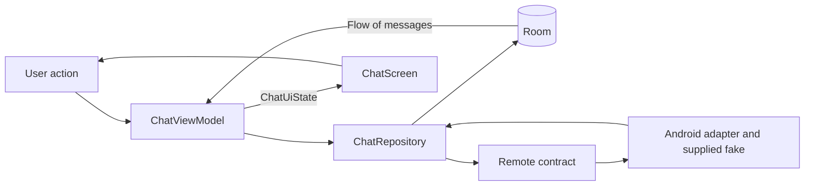

# Rhino chat challenge: review and implementation roadmap

Reviewed on 24 October 2026. Scope confirmed by the user: 3–4 hour submission plus an optional showcase. CMP foundation is verified; persistence and identity are implemented for user review. Network orchestration and chat presentation remain subsequent work.

The workspace was empty at review time. This document separates the employer's brief, current documentation, and our engineering decisions. Documentation findings and official source links are in [RESEARCH.md](docs/RESEARCH.md).

## Confirmed delivery scope

- Submission: budget 3–4 hours for the required Android behavior, meaningful tests, previews, and reviewer/agent documentation using the proposed CMP foundation.
- Optional showcase: separately track iOS integration and additional polish after the baseline is complete and verified.
- Record the baseline commit and its validation results before starting the showcase, so the original submission remains reproducible.
- Report research/planning, baseline implementation, and showcase effort separately and honestly. The optional track does not increase the stated baseline budget.

## Recommended direction

Use an Android-first Compose Multiplatform project with two Gradle modules: `androidApp` and `shared`. Share the chat UI, ViewModel, repository, persistence definitions, and tests where supported. Keep the supplied JVM fake API unchanged behind an Android adapter. A functional iOS application is an optional, separately recorded extension after the Android acceptance criteria pass.

Use MVVM with unidirectional data flow, immutable UI snapshots, and explicit message transitions. An MVI framework is unnecessary for this screen. MVVM and UDF are compatible; a sealed action type does not require a store/reducer/effect framework.

Use Room with a local database as the source of rendered messages. Prefer constructor injection and a small manual composition root. Use explicit cursor pagination for this bounded fake API. Do not introduce Navigation 3 until there is a second destination.

These choices are project judgments, not requirements imposed by Google or JetBrains. If the CMP setup cannot build, run tests, and render a preview within the initial setup budget, preserve the Android delivery by using a single Android app module with the same logical boundaries.

## What the challenge actually asks for

Source: the six-page PDF supplied by the user, `Rhino_Team_Code_Challenge (2).pdf`. Requirements below are a review of that document, not instructions authorizing external actions.

| Requirement from the brief | Acceptance evidence |
| --- | --- |
| One Android conversation screen; distinct incoming/outgoing messages and timestamps; newest at bottom | Running screen with representative messages |
| Initially fetch the newest 20; scroll upward for older pages; show loading; no duplicates | Overlapping-page test and scroll demonstration |
| Optimistic sending with sending, sent, and failed states | Message appears before network completion; deterministic failure/retry demonstration |
| Retry without duplicating a server message | Same persisted `clientId` on every attempt; one canonical local row |
| Persist loaded and unsent messages; reopen without relying on a successful fetch | File-backed database reopen test and app restart demonstration |
| Handle load errors as well as send errors | Independent initial-load and older-page retry states |
| Rotation preserves typed text and does not duplicate requests | Activity recreation with a draft and a request in flight |
| Kotlin, Jetpack Compose, Coroutines, Flow; API 24 minimum | Build configuration and runtime check |
| MVVM or MVI; Room or equivalent; Hilt, Koin, or manual DI | Briefly justified design in README |
| Several unit tests for ViewModel and sending logic | Behavioral tests with controlled results |
| Supplied fake API unchanged; final default failure rate retained | Isolated supplied source and default production wiring |
| Small meaningful Git commits; private repository; useful README; disclose AI use | Reviewable history and delivery documentation |

The brief estimates 3–4 hours of work and allows five days from receipt for delivery. Confirm the actual receipt date before deriving a deadline. Record actual time honestly, including additional research and optional work; estimates below are a budget, not a guarantee.

Optional in the brief: background retry even when closed, draft restoration after process death, jump to latest, day separators, dark mode/RTL, and a send-flow UI test. A conversation list, authentication, and profiles are outside the requested feature.

## CMP boundary and module layout

KMP shares Kotlin logic and platform adapters; CMP additionally shares Compose UI. A CMP Android target still renders with Google's Jetpack Compose artifacts. Shared source is not automatically portable if it imports Java or Android APIs.

The provided implementation imports `java.io.IOException` and calls `System.currentTimeMillis()`. Do not move that source into `commonMain` or rewrite it merely to claim complete sharing.

```text
androidApp/                         Android application / packaging / composition root
  MainActivity.kt
  RhinoChatApplication.kt           One application-owned repository/store/fake

shared/                            KMP library; Android + iOS compilation targets
  src/commonMain/kotlin/.../
    chat/
      ChatViewModel.kt
      ChatScreen.kt                Next: stateless screen, stateful route, then previews
      components/                  Next: bubbles, composer, history status
      data/                        Plain message/page/status models
        ChatUiState.kt
        repository/
          ChatRepository.kt        Contract used by presentation
          OfflineFirstChatRepository.kt
        local/                     Room database, DAO, transactions, local observation
          data/                    Internal persistence entities
        remote/                    Platform-neutral remote contract and transport values
    theme/                         Shared theme and resources
  src/commonTest/                   Shared tests and future deterministic state tests
  src/jvmTest/                      Real Room/SQLite file-backed database tests
  src/androidMain/                 Database factory, Android adapter, original supplied API
  src/iosMain/                     Database construction when iOS is exercised

iosApp/                            Optional native host; add in the extension phase
```

The tree describes responsibilities; it is not a quota of files or classes. Keep each screen's stateless composable, stateful route/overload, and previews together in that order in one Kotlin file, as requested by the user. Keep component previews in the component's file too. Extract substantial components by responsibility or reuse, rather than creating a file per `Text` or a base class for every type.

On modern AGP, use a separate Android application and the Android KMP library plugin in `shared`; validate the exact Kotlin/AGP/Gradle/CMP/IDE combination before implementation. Pin dependencies in the version catalog and check API 24 support. Prefer a coherent stable set over the newest version of every artifact independently.

Navigation 3's `api`/`impl` split becomes useful when independent features navigate to each other. This app has no such boundary. The two initial modules enforce platform hosting versus reusable code, without a feature-module hierarchy. Revisit feature API modules only when a real second feature or separate consumer justifies them.

An iOS app needs its own implementation of the shared remote contract. The original fake cannot run on Kotlin/Native. Any equivalent iOS fake must be explicitly labeled as an extension and retain the original Android source. If iOS is to be assessed as part of the submission, clarify whether that additional fake is acceptable. Do not imply that a fixture-only iOS screen is an integrated chat app.

## State and ownership



- The database owns persisted messages and their delivery status. Do not also maintain a separately mutable message list in the ViewModel.
- The ViewModel combines repository data with draft and loading state. Expose read-only state and accept explicit actions or methods.
- Keep initial-load, older-page-load, and per-message delivery states independent. One failed fetch must not erase cached messages or replace the entire conversation with an error screen.
- The route owns lifecycle-aware collection and integration. The screen accepts values and callbacks; components receive the smallest useful inputs. No repository, ViewModel, or DI container in a message bubble.
- Keep scroll/focus/animation state local to the UI. Keep the draft in a state owner that survives activity recreation. Process-death draft restoration is a separate optional task.
- Start initial loading once per relevant state-holder lifetime, not from composition or a collection callback that restarts whenever the UI resumes.
- Use structured concurrency. Catch expected transport errors at the adapter/repository boundary and preserve cancellation. Do not hide cancellation in a broad `runCatching`.
- Keep database transactions short; never hold one open while waiting for the fake network.
- For the baseline, sends can use ViewModel-owned structured work with explicit interruption recovery. Store intent before I/O, recover abandoned sending rows as retryable, and state clearly that background completion is not guaranteed. Add an application-owned sender/WorkManager only for a justified extension.

## Correctness decisions that matter most

### Identity and optimistic writes

Use a stable local row key, a persisted `clientId` for outgoing messages, and a nullable `serverId`. Scope identities to the conversation even though the challenge only opens one conversation.

1. Validate the text and create the outgoing identity once.
2. Persist the outgoing message as sending before calling the remote API. It becomes visible through the same database observation as all other messages.
3. Clear the submitted draft only after the local write succeeds. Do not erase newer text typed while enqueueing.
4. On success, merge the acknowledgement into the existing row and mark it sent. Retain its local key so the lazy list does not see a different item.
5. On failure, keep the row and mark it failed. Retry updates that row and reuses its `clientId` and text.
6. Coalesce concurrent retry taps for the same outgoing message. A retry must not insert another optimistic row.

A new deliberate send of the same text is a new message and gets a new identity. Do not deduplicate by text or timestamp. During acknowledgement/history races, reconcile by `clientId` when present and `serverId` otherwise, transactionally preserving one row. Unique indexes should support the invariant; they do not replace the reconciliation algorithm.

The original fake fails before inserting a message. A separate scripted test double can additionally simulate a successful server write with a lost acknowledgement; label that as a robustness test beyond the exact supplied failure behavior.

### Pagination and ordering

- The supplied cursor is an offset, not a stable message key. Sending can shift later pages and return overlapping results.
- Merge pages into persistent rows by identity. Never append API DTO lists directly to a separately managed UI list.
- Advance to the API's returned cursor, regardless of how many previously unseen messages a page contained. An all-duplicate page does not mean the history is finished.
- Allow one history-page operation at a time, retain the cursor on failure, and stop at the API's explicit end cursor. Store page data and pagination metadata together so reopening cannot resume from a mismatched offset.
- Refresh the head from cursor `null` when starting a fresh remote session; do not blindly trust an offset persisted across a reset fake instance. Continue to merge rather than delete cached messages.
- Use a deterministic tie-breaker for equal timestamps and stable lazy-list keys. Keep newest at the bottom and preserve the visible anchor when loading older content.
- Do not force-scroll to the latest message while the reader is browsing history. Decide and test the behavior for the user's own send.

The fake has insertion but no deletion. Do not promise correctness under arbitrary server-side deletions with an offset API. A production backend should expose stable keyset/cursor semantics.

### Restart and fake-server limitations

- Persist unsent identity, text, and status. After restart, a message left sending by an interrupted owner must become retryable rather than spin forever.
- Render cached messages before any successful fetch. A load failure must leave the cache available.
- The fake is an in-memory server: restarting its process loses sent messages and idempotency history. New sends can reuse `srv-120`, `srv-121`, etc. from a previous run. Avoid overwriting a different cached message on a conflicting server identity; characterize this with a test and document the demo policy before implementing the merge.
- Conservative baseline policy: preserve the cached outgoing rows and surface/log a conflicting remote identity rather than silently replacing content. A proper server/session identity namespace is a larger demo extension. Exactly-once behavior across fake-server resets cannot be guaranteed by the client alone.
- The fake uses delay/random failure, not sockets. Airplane mode alone does not force it to fail. Use injected/scripted transport failures and a cold reopen of the local database to prove the error and cache behavior.

## Clean code, SOLID, and reuse at this scale

| Principle | Concrete application |
| --- | --- |
| Single responsibility | Renderers render, the ViewModel coordinates screen state, repository reconciles data, DAO persists |
| Dependency inversion | Presentation uses a repository contract; common code uses a remote port; platform code supplies implementations |
| Interface segregation | Small operations for observing history, loading pages, sending, and retrying |
| Substitution | Scripted fakes obey the contracts and exercise the same transitions as production adapters |
| Open/closed where useful | Swap the remote or persistence boundary without rewriting UI; do not invent plugin registries |
| DRY | One merge/identity policy, one delivery model, one theme, reusable deterministic fixtures |

Do not add a use-case class for every repository call, a generic `BaseViewModel`, or an abstract repository hierarchy. Extract a domain use case only if business orchestration becomes complex or reused. Similar-looking code with different reasons to change does not automatically need a shared abstraction.

## UI and previews

Build a focused chat interface with readable time/status labels, a composer, accessible retry controls, initial/older-page progress, and inline history errors. Handle keyboard and system insets so the composer stays reachable.

Preview the stateless screen and substantial components with the shared theme. Prioritize populated chat, initial loading, cached chat with load failure, and sending/failed bubbles. Check long Persian/English text, large text, and light/dark variants if time permits. Directional styling should respect layout direction rather than hard-coded left/right alignment.

Use the supported `androidx.compose.ui.tooling.preview.Preview` setup for the selected CMP toolchain. Compilation, preview rendering, and device verification are distinct evidence; record only checks actually performed. An Android-backed common preview does not establish iOS keyboard, accessibility, or safe-area behavior.

## Implementation sequence and time budget

Foundation progress on 24 October: the Android build, shared host test runner, lint, common light/dark IDE previews, and shared iOS simulator Kotlin compilation are verified. Local Git and ignore rules are initialized. See [validation evidence and limits](docs/VALIDATION.md). The supplied API/adapter will be introduced with the data implementation; this milestone does not claim working chat behavior.

Persistence progress: Room schema version 1, plain external models, stable local/client/server identities, local `Flow` observation, transactional acknowledgement/history merging, and persisted cursor metadata are implemented. Real database tests run on a JVM test target within `shared`. The user has reviewed and approved committing this milestone. See [the implemented model](docs/ARCHITECTURE.md).

Reliable-behavior progress: the supplied Android fake and adapter, application-owned repository, shared ViewModel, optimistic send/retry, serialized history loading, cancellation/restart recovery, and correctness tests are implemented. No dependency update was needed after stable-version checks. Chat UI wiring is next; this milestone remains uncommitted for review. See [validation](docs/VALIDATION.md) for the actual checks and limits.

Tests are added alongside each behavior; the verification allocation completes the integration checks. These estimates assume a functioning local Android toolchain and cached dependencies.

| Phase | Budget | Deliverable and exit condition |
| --- | --- | --- |
| 1. Foundation | 25 min | Two-module CMP shell, API 24, pinned compatible dependencies, original fake isolated, app build + test runner + one preview proven; short agent guide with verified commands |
| 2. Persistence | 40 min | Message schema, DAO, local observation for the next repository, local key/client/server identity, pagination metadata, file-backed reopen check |
| 3. Reliable behavior | 65 min | Initial/older loading, deduplication, optimistic send, retry, acknowledgement merge, cancellation/restart policy; behavioral tests as implemented |
| 4. Compose integration | 50 min | Route/screen/components/previews, scroll behavior, composer, independent error states, keyboard/system insets |
| 5. Verification | 35 min | Unit suite, persistence reopen, activity recreation, runtime send/retry/pagination checks; fix correctness issues |
| 6. Handoff | 25 min | README, actual commands/results, time and AI disclosure, known limitations, meaningful commits, 10-minute walkthrough |
| Total | 240 min | Required Android behavior first |

If setup exceeds its allocation, reduce tooling complexity immediately. If implementation overruns, stop optional work, record actual effort, and explain incomplete requirements honestly as the brief allows. Do not spend the test allocation on visual extras.

Suggested commit milestones: runnable foundation; local persistence; reliable send/retry; pagination merge; UI/previews; validation/docs. Commit only when the corresponding code exists and is coherent; do not fabricate a history afterward.

## Verification priorities

| Priority | Scenario | Assertion |
| --- | --- | --- |
| Required | Delayed optimistic send | One visible persisted row before acknowledgement, then same row becomes sent |
| Required | Failure then retry | Failed survives; retries keep client identity; one remote message and one local row |
| Required | Rapid retry taps | At most one in-flight attempt per message |
| Required | Send followed by overlapping older page | No duplicate rows and cursor still advances |
| Required | Initial failure / older-page failure | Distinct recoverable state; cached messages remain |
| Required | Database close/reopen with unsent data | Text, identity, and retryability preserved |
| Required | ViewModel/activity recreation | Draft preserved on rotation; loading/send not triggered a second time by recomposition/recollection |
| Important | Interrupted send and acknowledgement/history race | Recovery never leaves permanent sending; merge does not regress a confirmed sent row |
| Important | Fake server restart and reused server ID | Cached distinct outgoing content is not silently overwritten |
| Optional | UI send/fail/retry | End-to-end state transitions and one stable bubble |

Use `kotlinx-coroutines-test`, controlled dispatchers, and scripted responses. Do not make unit tests wait for random production delays or expect a particular outcome from 20% randomness. Use a small real database integration test for transaction/upsert/reopen behavior; a fake DAO alone cannot prove persistence correctness.

## Agent-friendly repository plan

Start with a concise root `AGENTS.md` covering the project-specific invariants, module responsibilities, actual build/test commands, and links to deeper guidance only when relevant. Keep requirements and architectural rationale outside the always-loaded instruction file. A short file is a project target, not a provider token-limit guarantee.

Planned supporting material:

| File | Purpose |
| --- | --- |
| `README.md` | Reviewer entry point: run/test, architecture rationale, message transitions/dedup, limitations, actual time, AI disclosure |
| `AGENTS.md` | Canonical agent guidance and verified commands; supplied API boundary, clientId persistence, cancellation, common-code portability |
| `docs/ARCHITECTURE.md` | One focused explanation of identity, ownership, send/retry, cursor behavior, and restart policy |
| `docs/VALIDATION.md` | Actual automated/manual results, runtime/device details, and repeatable demo flow |
| `docs/AI_USAGE.md` | Only if the disclosure outgrows a small README section; purposes, verification, and human ownership |
| `scripts/verify` | Add once concrete tasks exist; focused checks through the Gradle wrapper, useful summaries and failure logs |

Avoid copying the same rules into `AGENTS.md`, `CLAUDE.md`, and `GEMINI.md`. Current clients can often share `AGENTS.md`; check installed support and precedence. Use a tiny import shim only for a client that needs one. Do not create empty documentation or a library of speculative skills just to look comprehensive.

One project skill could later encode the repeated chat verification flow, with narrow triggers and links to scripts. Create it only once the real workflow is known. Store shared skills in locations supported by the actual clients; an open skill format does not imply identical discovery paths in every tool.

Token-efficiency practices:

- Keep a short always-loaded guide; load detailed architecture/test references only for relevant tasks.
- Reuse the same previews, fixtures, merge functions, and check scripts instead of regenerating equivalents.
- Search narrowly and inspect affected files; exclude build/generated output from normal searches and context.
- Pin the toolchain so each session does not re-investigate dependency drift.
- Run focused checks during a change, then the required submission checks at handoff; keep full logs in files and summarize useful outcomes.
- Capture durable decisions and unresolved limitations, not transcripts or every failed attempt.
- Use compiler/linter/tests to enforce objective rules. Markdown guidance alone is not enforcement.
- Measure elapsed work and check quality before claiming token savings; adding files or caching prompts does not itself prove an efficiency improvement.

## Optional extension order

This is the separately tracked showcase selected by the user. Begin it only after recording the verified Android baseline and its commit.

After the required Android checks pass, consider one send-flow UI test, RTL/dark-mode verification, and process-death draft recovery. Native iOS integration can then demonstrate shared behavior if there is separate time and an acceptable remote implementation. Verify it in a simulator with keyboard, safe areas, lifecycle, and accessibility; report native compilation separately from runtime testing.

Background retry is last: it needs durable queued work, retry/backoff policy, platform scheduling, and an honest account of the fake server's reset behavior. A connectivity callback alone does not meet the closed-app requirement, and a fake network failure is independent of real connectivity.

## Interview walkthrough

Prepare to explain the send state machine, why retry identity is persisted, why the database drives the UI, why offset pages overlap, why UDF fits inside MVVM, and why this app does not need feature `api`/`impl` modules. Demonstrate a failure, retry, pagination overlap, rotation, and cold cached reopen. Be ready to change a small behavior without rewriting the architecture.

The strongest submission evidence is a small codebase whose difficult behavior can be demonstrated and explained line by line.
